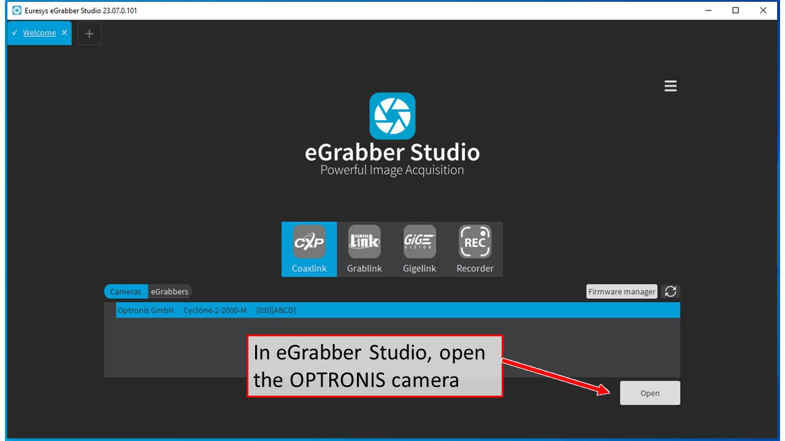
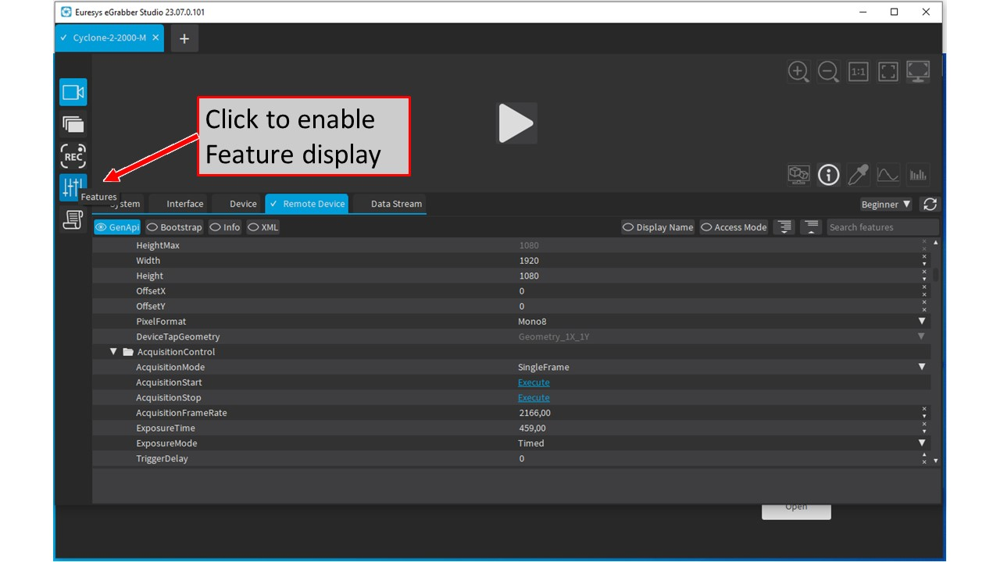
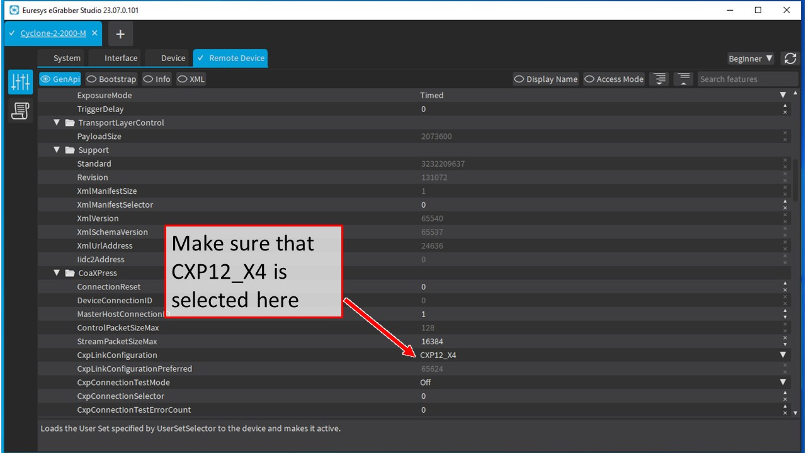
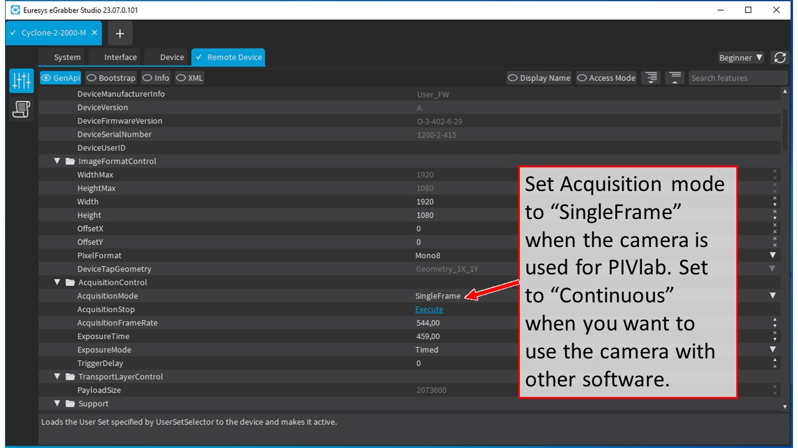
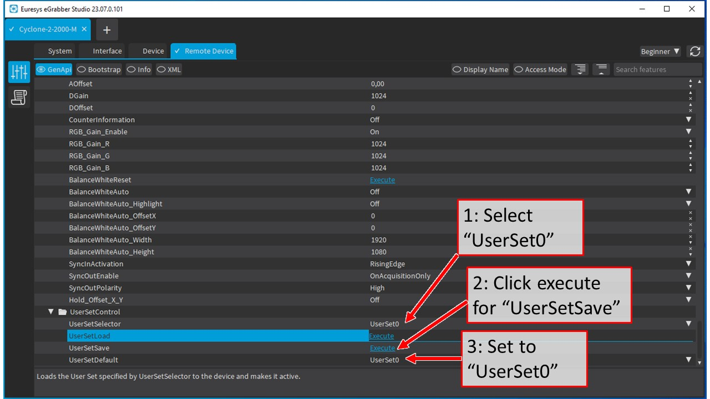
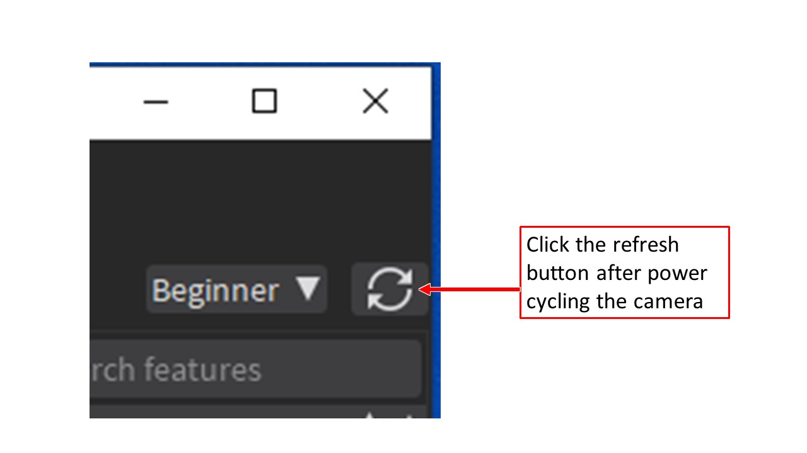

Supported models: [Cyclone-25-150-M](https://optronis.com/produkte/cyclone-25-150/), [Cyclone-1HS-3500-M](https://optronis.com/produkte/cyclone-1hs-3500/) and [Cyclone-2-2000-M](https://optronis.com/produkte/cyclone-2-2000/). PIVlab detects the model automatically and records 8-bit images.

## 1. Install the software

<!-- switch: edition -->

### Standalone app

<!-- switch: grabber -->

#### BitFlow frame grabber

1. 
2. 
3. 

#### Euresys frame grabber

1. 
2. 

### MATLAB toolbox

<!-- switch: grabber -->

#### BitFlow frame grabber

1. 
2. 
3. 
4. 
5. 

#### Euresys frame grabber

1. 
2. 
3. 
4. 

## 2. Connect the camera

1. Connect the camera to the frame grabber with the four coaxial cables, in this order: **1-A, 2-B, 3-C, 4-D**.
2. Connect the trigger cable from the camera's Aux port (**Sync in**) to the synchronizer or laser.
3. Power the camera with the supplied power supply (or directly via CoaXPress).
4. Check the back of the camera: all four lights are solid green when the connection is ready.

## Set the camera to external triggering (Euresys only)

With a Euresys frame grabber, the camera has to be set to external triggering once, in **eGrabber Studio**. The setting is stored in the camera. Cameras bought from OPTOLUTION are already set up, so you can skip this step.

1. Open eGrabber Studio and make the settings shown in these screenshots:

    

    

    

    

    

2. Power cycle the camera and click the refresh button:

    

3. Check that the changed settings are still there after the power cycle.

## 3. Start capturing

1. Start PIVlab and open the image acquisition panel.
2. Select the configuration **PIVlab LD-PS + OPTRONIS Cyclone**. The camera model is detected automatically.
3. Connect to the synchronizer / laser in PIVlab and start your PIV recordings.

## How many images fit into RAM

High-speed recordings go into the computer's RAM first, so that no frame is lost, and are saved to disk afterwards. Approximate number of double images with a Cyclone-2-2000-M (8 bit):

| RAM | Double images |
|---|---|
| 16 GB | 1300 |
| 32 GB | 3400 |
| 64 GB | 7500 |

PIVlab shows the maximum for your computer: if you ask for more images, the field turns orange and PIVlab warns you before recording. A fast, large SSD makes saving the recording quicker.
